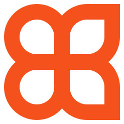
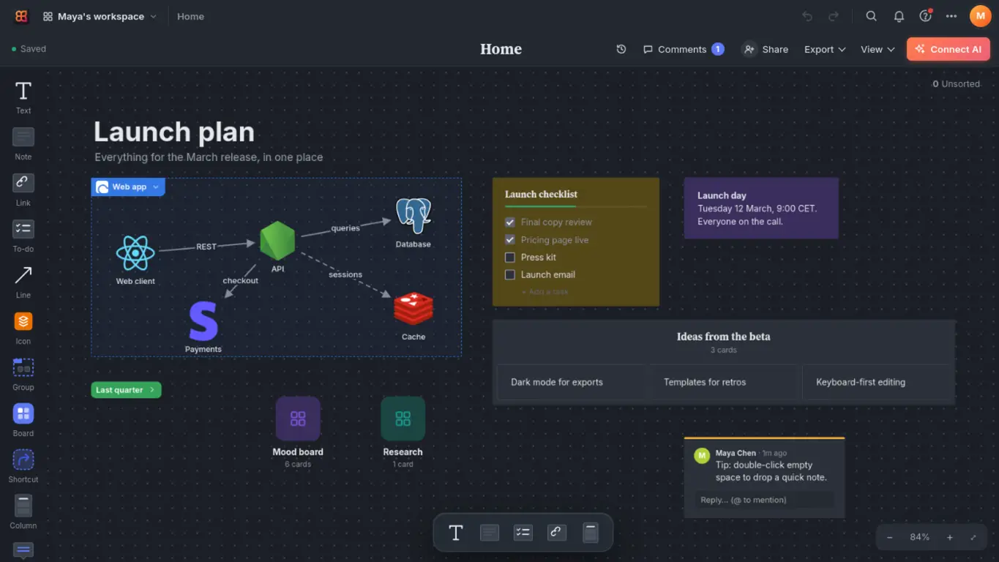

<div align="center">



# Kolam

**An infinite canvas for everything in your head — notes, to-dos, links, images, docs and sketches — that you can host yourself.**

[](LICENSE)
[](https://github.com/venkeywonder/kolam-oss/actions/workflows/check.yml)


[Quick start](#-quick-start) · [Features](#-what-you-get) · [Self-hosting](docs/self-hosting.md) · [Architecture](docs/architecture.md) · [Contributing](CONTRIBUTING.md)



</div>

---

A *kolam* is the pattern drawn in rice flour at the doorstep of South Indian homes every morning: a few dots, a few
lines, and something beautiful takes shape. This app works the same way. Drop a note here, a link there, pull them into
columns, nest boards inside boards, and the shape of your project shows up.

It's a plain PHP app with a vanilla JavaScript frontend. No framework, no bundler, no `node_modules`. Clone it, run it
and your boards are on your own server.

## ✨ What you get

| | |
|---|---|
| 🧩 **Cards for everything** | Notes, to-dos with due dates, links with previews, images, files, tables with formulas, rich documents, sketches, freehand drawing, colour swatches and embeds. |
| 🪆 **Boards inside boards** | Nest boards as deep as you like, then put a shortcut to any of them on any other board. |
| 👥 **Built for teams** | Workspaces with roles, per-board sharing, and view / comment / join links with optional passwords and expiry dates. |
| ⚡ **Live collaboration** | See who's here and what they're editing. Edits merge field by field, and rich text merges character by character (thanks to [Yjs](https://yjs.dev)). |
| 💬 **Comments and history** | Threads on any card with @mentions and reactions, a per-board activity feed, and version history you can restore from. |
| 🤖 **Bring your own AI** | A built-in MCP server lets Claude Code, Codex or any MCP client read and change your boards. You use your own subscription; Kolam never calls an AI API. |
| 📴 **Works offline** | Boards are cached in the browser, so they open instantly and keep your edits when the network drops. |
| 📦 **Your data, your way** | SQLite out of the box, or MySQL / MariaDB / PostgreSQL. Files on local disk or any S3-compatible bucket. Export everything as JSON + Markdown at any time. |

## 🚀 Quick start

You need PHP 8.1+ with `pdo_sqlite`, `curl`, `mbstring` and `fileinfo`. That's the whole list.

```bash
git clone https://github.com/venkeywonder/kolam-oss.git kolam && cd kolam
cp .env.example .env
PHP_CLI_SERVER_WORKERS=4 php -S localhost:8080 server/router.php
```

Open **<http://localhost:8080>**, create your account and start dropping cards. The first account on a server can
always sign up. Set `ALLOW_SIGNUP=false` in `.env` afterwards if you'd rather not have company.

> [!TIP]
> Already running XAMPP, MAMP or any Apache with PHP? Put the folder in `htdocs` and open it in the browser. The
> included `.htaccess` files take care of the rest.

## 🏠 Hosting it for real

Kolam runs on a small VPS or on shared hosting. All it needs is PHP. The [self-hosting guide](docs/self-hosting.md) covers:

- **Ubuntu + nginx** step by step, with ready-made configs in [`deploy/`](deploy)
- **aaPanel** and other control panels
- **Live updates** through the optional WebSocket server (without it, browsers poll about once a second)
- **Email** for invitations and password resets (any SMTP provider)
- **Scaling** to several app servers behind a load balancer
- **Running a public instance**: email verification, bot checks, abuse reports and an admin page

Every setting lives in [`.env.example`](.env.example), with a comment explaining what it does.

## 🤖 Connect Claude Code or Codex

```bash
claude mcp add --transport http kolam https://your-kolam.example.com/api/mcp
# or
codex mcp add kolam --url https://your-kolam.example.com/api/mcp
```

A Kolam sign-in page opens and you click **Allow**. After that you can ask *"turn my meeting notes into a to-do
column"* or *"make a board for each chapter of my book"*, and your open tabs update within seconds. The AI can only
reach what your account can reach. See [Collaboration and AI](docs/collaboration.md#connect-your-ai-claude-code--codex-over-mcp)
for the full list of tools.

## 🧭 Find your way around

| Read this | If you want to |
|---|---|
| [docs/self-hosting.md](docs/self-hosting.md) | Install, deploy, configure and maintain a server |
| [docs/architecture.md](docs/architecture.md) | Understand the code layout, how sync and merging work, or add a card type |
| [docs/collaboration.md](docs/collaboration.md) | Learn how workspaces, sharing, links, comments, history and MCP behave |
| [CONTRIBUTING.md](CONTRIBUTING.md) | Send a fix or a feature |
| [SECURITY.md](SECURITY.md) | Report a vulnerability privately |

## 🤝 Contributing

Bug reports, fixes, new card types and docs improvements are all welcome. Because there's no build step, editing a file
and reloading the browser is the whole dev loop. Start with [CONTRIBUTING.md](CONTRIBUTING.md), look for issues labelled
[`good first issue`](https://github.com/venkeywonder/kolam-oss/labels/good%20first%20issue), or say hi in
[Discussions](https://github.com/venkeywonder/kolam-oss/discussions).

## ☁️ Don't want to host it?

[**trykolam.com**](https://trykolam.com) runs Kolam for you, with backups, email and updates handled. Subscribing is
also the best way to support the project.

## 📄 License

Kolam is free software under the [GNU Affero General Public License v3.0](LICENSE). Use it, change it, host it. If you
run a modified version as a service for other people, share your changes with them too. The bundled Yjs and lib0
(`src/vendor/yjs.js`) are MIT-licensed, Lucide icons (`src/vendor/lucide.json`) are ISC-licensed, and the logo packs in
`src/vendor/logos/` keep their own terms; the AWS Architecture Icons there are AWS's, for architecture diagrams (see
[its README](src/vendor/logos/README.md)).

<div align="center">
<sub>Made with ☕ and a lot of rice-flour dots.</sub>
</div>
